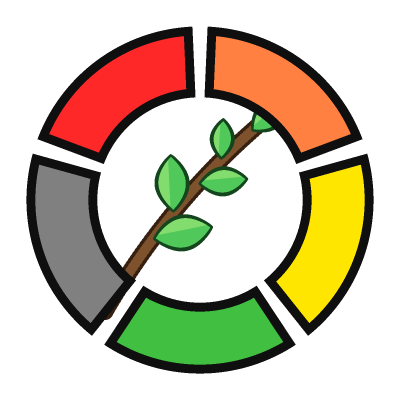

# HerbRings

Puts a coloured ring on every herb spawn point on your minimap, coloured by how likely you are to get a skill-up from it. Made for WoW: Forever.

| Colour  | Meaning |
|---------|---------|
| Red     | Your skill is too low |
| Orange  | Guaranteed skill-up |
| Yellow  | Likely skill-up |
| Green   | Small chance |
| Gray    | No skill-up |
| Blue    | New Forever herb, requirement not known yet |

Hover a ring to see which herb it is and what it needs. Herbs you mouse over in the world get the same colouring in their tooltip.

The rings show where herbs *can* spawn, not what's up right now. Forever doesn't let addons read the minimap's herb dots, so the game's own tracking dot is still what tells you a herb is there. Find Herbs plus a ring around the dot is the idea.

## Requirements

**Questie.** Spawn points come from its database, which includes Forever's new spawns. Without it you only get the tooltip colouring.

Now and then a herb grows where Questie has no spawn point. When you pick one there, HerbRings saves the spot and puts a ring on it from then on. Saved spots are shared by all your characters. `/hrings forget` removes the ones near you.

## Settings

Esc > Options > AddOns > HerbRings, or `/hrings config`.

- Ring size, opacity and range
- Change any of the colours, or hide a colour entirely (gray and red are the usual ones to hide)
- Every herb listed by required skill: hide it, or give it its own colour

Colours update as you level. A herb you've given its own colour keeps it.

`/hrings help` lists the slash commands.

## Notes

- Skill requirements match Classic. The skill-up bands (25 / 50 / 100 above the requirement) are the Classic ones too and can be changed in the settings if Forever turns out to differ.
- Demonsage, Marefoil and Death Lotus show as blue until their requirements are known.

## Credits

Uses [HereBeDragons](https://github.com/Nevcairiel/HereBeDragons) by Nevcairiel for minimap placement. Spawn data from [Questie](https://github.com/Questie/Questie).
